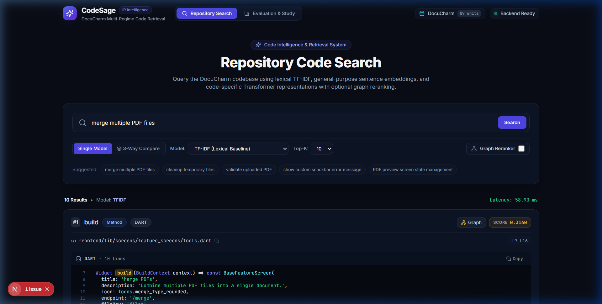
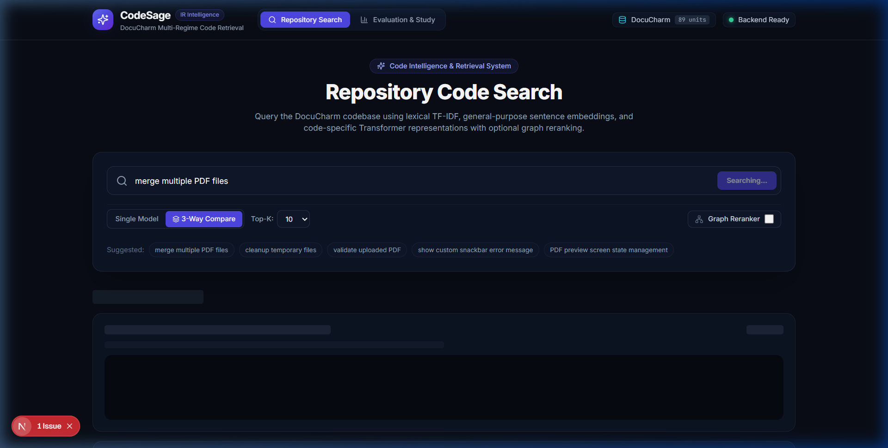
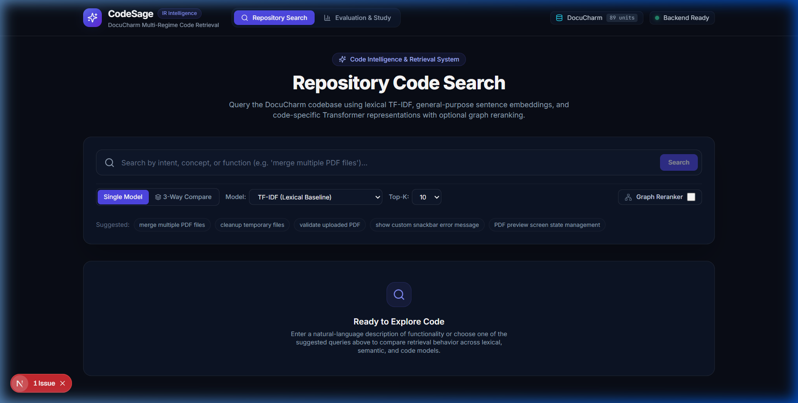

# CodeSage: Codebase Intelligence & Retrieval Benchmark

CodeSage is a research-grade codebase intelligence, search, and evaluation platform. It investigates how traditional lexical information retrieval, general-purpose sentence transformers, code-specific bi-encoders, and syntax-aware relationship graph reranking compare on real-world, multi-language software repositories.

---

## Architecture Overview

```text
                                       User Query (Natural Language)
                                                     │
                             ┌───────────────────────┼───────────────────────┐
                             ▼                       ▼                       ▼
                     ┌───────────────┐       ┌───────────────┐       ┌───────────────┐
                     │    TF-IDF     │       │  all-MiniLM   │       │ st-codesearch │
                     │  (Subwords)   │       │    (Dense)    │       │ (DistilRoBERTa│
                     └───────┬───────┘       └───────┬───────┘       └───────┬───────┘
                             │                       │                       │
                             └───────────────────────┼───────────────────────┘
                                                     ▼
                                           Candidate Set (Top K)
                                                     │
                                                     ▼
                                      ┌──────────────────────────────┐
                                      │   Repository Relationship    │
                                      │   Graph Context Reranker     │
                                      │  (AST Syntax / Call Affinity)│
                                      └──────────────┬───────────────┘
                                                     │
                                                     ▼
                                       Final Ranked Code Units
                                                     │
                                ┌────────────────────┴────────────────────┐
                                ▼                                         ▼
                     ┌──────────────────────┐                  ┌──────────────────────┐
                     │ Next.js Web Frontend │                  │  FastAPI REST API    │
                     │ (TypeScript/Tailwind)│                  │ (Pydantic / Uvicorn) │
                     └──────────────────────┘                  └──────────────────────┘
```

### Repository Structure

```text
codesage/
├── README.md                      # Project documentation and benchmark overview
├── LICENSE                        # MIT Open Source License
├── requirements.txt               # Pinned Python dependencies
├── pytest.ini                     # Pytest runner configuration
├── .gitignore                     # Git isolation (caches, node_modules, .venv, models)
├── docs/
│   ├── research_report.md         # Formal comparative IR research report (RQ1–RQ5)
│   ├── reproduction_guide.md      # Deterministic step-by-step reproduction instructions
│   └── screenshots/               # Actual captured interface screenshots
│       ├── search_home.png        # Web UI repository search homepage
│       ├── search_results.png     # Ranked search results with syntax-highlighted code
│       └── comparison_view.png    # 3-way side-by-side model comparison view
├── src/codesage/
│   ├── config.py                  # Scanning parameters, extensions, and privacy filters
│   ├── scanner.py                 # Deterministic filesystem scanner (DocuCharm isolation)
│   ├── extractors.py              # Tree-sitter AST extractors for Dart, JS, and Python
│   ├── indexer.py                 # Manifest generator and JSONL pipeline coordinator
│   ├── tokenization.py            # Code-aware subword tokenizer (camelCase/snake_case)
│   ├── retrieval.py               # TF-IDF lexical search engine with char n-grams
│   ├── semantic.py                # General-purpose sentence embedding engine (all-MiniLM-L6-v2)
│   ├── code_semantic.py           # Code-specific transformer engine (st-codesearch-distilroberta-base)
│   ├── graph.py                   # Deterministic repository relationship graph builder
│   ├── graph_reranker.py          # Graph context affinity reranker
│   ├── evaluation.py              # Statistical evaluation engine (Bootstrap CIs, Wilcoxon tests)
│   └── api.py                     # FastAPI REST backend with bounded payloads & validation
├── scripts/
│   ├── build_graph.py             # CLI: Construct syntax-aware relationship_graph.json
│   ├── search.py                  # CLI: Terminal code search runner
│   ├── evaluate.py                # CLI: Comparative IR evaluation runner
│   ├── evaluate_graph.py          # CLI: Graph context reranking evaluation runner
│   ├── run_experiments.py         # CLI: Milestone 5 ablation study and split runner
│   ├── serve_api.py               # CLI: Uvicorn API server runner
│   └── validate_queries.py        # CLI: Query set audit and split isolation validator
├── tests/
│   ├── test_scanner.py            # Scanner boundaries & secrets exclusion tests (11 tests)
│   ├── test_extractors.py         # Tree-sitter AST code extraction tests (6 tests)
│   ├── test_retrieval.py          # TF-IDF ranking, tie-breaking & tokenization tests (10 tests)
│   ├── test_semantic.py           # Sentence embeddings & cache invalidation tests (8 tests)
│   ├── test_code_semantic.py      # Code transformer & sequence truncation tests (9 tests)
│   ├── test_evaluation.py         # IR metrics (MRR, Recall, nDCG) calculation tests (4 tests)
│   ├── test_study.py              # Split isolation & bootstrap CI math tests (5 tests)
│   ├── test_graph.py              # Relationship graph & reranking affinity tests (6 tests)
│   └── test_api.py                # FastAPI REST endpoints & input validation tests (8 tests)
├── data/
│   ├── code_units.jsonl           # 89 indexed code units from DocuCharm
│   ├── evaluation_queries.jsonl   # 40 audited queries (18 Dev, 18 Held-Out Test, 4 Negative)
│   ├── relationship_graph.json    # 105 nodes, 378 edges, 876 explicit unresolved references
│   ├── manifest.json              # Ingestion run metadata and SHA-256 fingerprint
│   └── experiments/               # Empirical experiment reports and CSVs
└── web/                           # Next.js 16 + React 19 + Tailwind CSS v3 Web Application
    ├── src/app/                   # App Router pages (/ and /evaluation)
    ├── src/components/            # UI components (Navbar, CodeViewer, CompareView, Modal)
    └── package.json               # Node.js dependencies
```

---

## Supported Languages & Code Extraction

CodeSage uses Tree-sitter concrete syntax trees to extract self-contained code units (classes, functions, methods, and line-chunk fallbacks) with precise line ranges and symbol hierarchies:

| Language | Extractor Engine | Extracted Construct Types | Fallback Mechanism |
| :--- | :--- | :--- | :--- |
| **Dart** (`.dart`) | `tree-sitter-dart` | `class`, `method`, `function` | Line-chunk splitting (bounded <= 120 lines) |
| **JavaScript** (`.js`, `.jsx`, `.mjs`) | `tree-sitter-javascript` | `class_declaration`, `function_declaration`, `method_definition`, `arrow_function` | Line-chunk splitting (bounded <= 120 lines) |
| **Python** (`.py`) | Python standard `ast` | `ClassDef`, `FunctionDef`, `AsyncFunctionDef` | Line-chunk splitting (bounded <= 120 lines) |

---

## Model Comparison & Architecture

CodeSage compares four distinct retrieval strategies:

1. **TF-IDF with Subword n-grams (`tfidf_char_ngrams`)**:
   - Sublinear term frequency scaling with code-aware tokenization (splits `camelCase` and `snake_case`).
   - Feature union combining word n-grams $(1, 2)$ with character boundary n-grams $(3, 5)$.
   - Model size: **0 MB**. Latency: **7.85 ms**.

2. **General-Purpose Sentence Transformer (`all-MiniLM-L6-v2`)**:
   - 384-dimensional dense embeddings trained via contrastive learning on general natural language.
   - 256-token context window with mean pooling and $L_2$ normalization.
   - Model size: **86.7 MB**. Latency: **36.60 ms**.

3. **Code-Specific Transformer (`st-codesearch-distilroberta-base`)**:
   - 768-dimensional dense bi-encoder pretrained on CodeSearchNet (docstring-to-code alignment).
   - 512-token context window with mean pooling and $L_2$ normalization.
   - Model size: **313.3 MB**. Latency: **65.34 ms**.

4. **Repository Relationship Graph Context Reranker (`graph_reranked`)**:
   - Syntactic graph containing 105 nodes and 378 typed edges (`DEFINES`, `MEMBER_OF`, `CONTAINS_METHOD`, `EXTENDS`, `IMPORTS_FILE`, `IMPORTS_SYMBOL`, `CALLS`, `CONSTRUCTS`).
   - Blends candidate text score with structural neighborhood affinity ($\alpha=0.75, \beta=0.25$).
   - Latency overhead: **+0.42 ms**.

---

## Dataset Construction & Evaluation Protocol

- **Target Repository**: DocuCharm (PDF productivity tool with Flutter frontend and Node.js backend; 89 indexed code units).
- **Grounding Guarantee**: 100% of relevance labels in `data/evaluation_queries.jsonl` are grounded in actual extracted code units. Zero hallucinated IDs exist.
- **Strict Split Isolation**:
  - **Development (`dev`)**: 18 queries used for parameter tuning and tokenization design.
  - **Held-Out Test (`test`)**: 18 queries strictly unseen during system development.
  - **Negative Controls (`negative_control`)**: 4 unsupported queries (authentication, SQL, Kubernetes) verifying false-positive behavior.
  - **Leakage Verification**: Zero lexical or intent overlap between `dev` and `test` splits.
- **Statistical Rigor**:
  - Non-parametric 95% bootstrap confidence intervals (1,000 resamples).
  - Paired Wilcoxon signed-rank tests and paired Student's t-tests across shared query pairs.

---

## Actual Empirical Results

All reported figures are measured directly from the evaluation pipeline (`data/experiments/`).

### Primary Benchmark: Held-Out Test Set (18 Queries)

| Retrieval System | Recall@1 | Recall@5 | Recall@10 | MRR | nDCG@5 | nDCG@10 | Median Latency |
| :--- | :---: | :---: | :---: | :---: | :---: | :---: | :---: |
| **TF-IDF (+ Char n-grams)** | **0.5093** | **0.8333** | 0.9167 | **0.8519** | **0.7805** | **0.8188** | 7.85 ms |
| **TF-IDF (Word n-grams)** | 0.4630 | 0.8241 | **0.9815** | 0.7338 | 0.7236 | 0.7901 | **2.42 ms** |
| **General Semantic (`all-MiniLM`)** | 0.4259 | 0.8241 | 0.8889 | 0.8148 | 0.7315 | 0.7600 | 36.60 ms |
| **Code Transformer (`st-codesearch`)**| 0.4352 | 0.7500 | 0.8519 | 0.7886 | 0.7098 | 0.7454 | 65.34 ms |

### Graph Context Reranking Impact (Full 36 Positive Queries)

| Base Model | Base MRR | Reranked MRR | Base Recall@5 | Reranked Recall@5 | Recall@5 Gain | Overhead |
| :--- | :---: | :---: | :---: | :---: | :---: | :---: |
| **TF-IDF Standard** | 0.7743 | **0.8035** | 0.8333 | **0.8519** | **+1.86%** | **+0.42 ms** |
| **General Semantic (`MiniLM`)** | 0.7959 | 0.7882 | 0.8171 | **0.8519** | **+3.48%** | **+0.38 ms** |
| **Code Transformer (`DistilRoBERTa`)**| 0.8457 | 0.8125 | 0.7616 | **0.7824** | **+2.08%** | **+0.41 ms** |

### Key Empirical Findings

1. **Subword TF-IDF wins overall accuracy on held-out test data**: Character subword n-grams achieved the highest test MRR (0.8519) and Recall@1 (0.5093) with zero neural weight overhead.
2. **Dense neural models suffer deep recall degradation**: Standard TF-IDF achieved **0.9815 Recall@10**, whereas dense embeddings suffered loss of rare exact identifiers, achieving 0.8889 and 0.8519.
3. **Out-of-Distribution Transfer Penalty**: CodeSearchNet models achieved high MRR (0.900) on in-distribution JavaScript, but degraded on Dart Flutter widgets (0.729 Recall@5 vs 0.875 for TF-IDF), reflecting the lack of Dart in CodeSearchNet pretraining.
4. **Graph Neighborhood Boosting**: Graph reranking provides consistent Recall@5 gains (+1.9% to +3.5%) across all three paradigms by elevating related companion methods into top-5 slots with less than 0.5 ms overhead.

---

## Interactive Web Interface

The CodeSage web dashboard provides an interactive workspace for code retrieval, model comparison, and benchmark inspection.

### Screenshots

#### Repository Search & Syntax-Highlighted Viewer


#### 3-Way Side-by-Side Model Comparison


#### Search Homepage


---

## Quickstart & Local Setup

### 1. Python Backend Setup

```bash
# Clone and enter directory
cd codesage

# Create and activate virtual environment
python -m venv .venv
source .venv/bin/activate  # On Windows: .venv\Scripts\Activate.ps1

# Install dependencies
pip install -r requirements.txt

# Run full test suite (all 65 tests)
pytest -v
```

### 2. Launch FastAPI Backend Service

```bash
python scripts/serve_api.py --port 8000
```
- API Base URL: `http://127.0.0.1:8000`
- Interactive OpenAPI Docs: `http://127.0.0.1:8000/docs`

### 3. Launch Next.js Web Interface

In a second terminal:
```bash
cd web
npm install
npm run dev
```
- Open browser at `http://localhost:3000`
- Navigate to `/` for Search & Comparison, or `/evaluation` for Empirical Benchmark Metrics.

---

## Limitations & Scope Boundaries

1. **Corpus Scale**: The DocuCharm repository contains 89 indexed code units across 16 files. Vocabulary collision dynamics may differ on enterprise codebases containing millions of lines.
2. **Static AST Analysis**: The relationship graph operates strictly via static syntax queries without runtime symbol evaluation. Dynamic method dispatch in JavaScript produces 876 explicit unresolved references rather than speculative guesses.
3. **Hardware Execution**: All evaluations and benchmarks were conducted entirely on local CPU hardware without GPU acceleration.
4. **Safety & Isolation**: The underlying DocuCharm application remains 100% untouched. CodeSage code execution, arbitrary shell access, and external data transmission are strictly disallowed.

---

## Documentation Links

- [Research Evaluation & Technical Report](docs/research_report.md)
- [Deterministic Reproduction Guide](docs/reproduction_guide.md)
- [MIT License](LICENSE)
